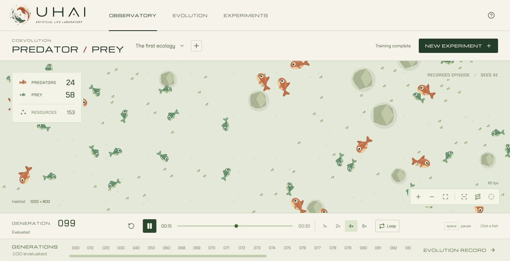

<div align="center">

# UHAI

**Artificial life laboratory**

*Watch life find its own way.*

</div>



<div align="center">

Observe neural organisms move, compete, and evolve in a shared habitat.

*Uhai* means life in Kiswahili.

</div>

---

## Start exploring

You'll need **Rust stable**, **Python 3.12**, **uv**, and **Node 22.12 or newer**.

Start the simulation server from the project root:

```sh
uv sync --python 3.12
uv run uvicorn apps.server.api.main:app --host 127.0.0.1 --port 8000
```

In a second terminal, start the interface:

```sh
cd apps/web
npm ci
npm run dev
```

Open **http://127.0.0.1:5173**. On Apple Silicon, if an older Node version is being picked up, run `export PATH="/opt/homebrew/bin:$PATH"` first.

## Explore

**Observatory** is the habitat. Click a fish to inspect it, drag to pan, and scroll to zoom. Use the playback controls to pause, seek, change speed, or loop the episode. Playback starts at 2× and runs independently of training.

**Evolution** shows captures and survival across generations. Choose **Watch founders**, **Watch latest**, or a marked generation on a chart to open its episode in the Observatory. Selection scores and research comparisons are available below the charts.

**Experiments** lets you configure runs. Training happens in a separate process, so you can watch a recording while it runs.

---

## Under the surface

Each organism is controlled by a small neural network with local sensory inputs and continuous movement outputs. Predator and prey populations evolve separately through selection, mutation, and repeated evaluations. Experiments use explicit seeds and save checkpoints for later replay and comparison.

The current release is an early research instrument. It does not establish sophisticated hunting or cooperation. Networks have a fixed topology, training uses one process, and sensory occlusion and behavioural classifiers are not yet implemented.

- [Architecture and execution plan](docs/architecture.md)
- [Observatory rendering results](docs/rendering-phase1.md)
- [Controlled learning measurements](docs/learning-results.json)

Experiment data lives in `experiments/data/` and is excluded from Git.

---

## Development

After changing Rust code, rebuild the Python extension:

```sh
uv sync --reinstall-package uhai
```

Run the checks from the project root:

```sh
cargo test
cargo clippy --all-targets -- -D warnings
uv run pytest -q
uv run ruff check apps scripts tests
```

For the frontend:

```sh
cd apps/web
npm test
npm run build
```
